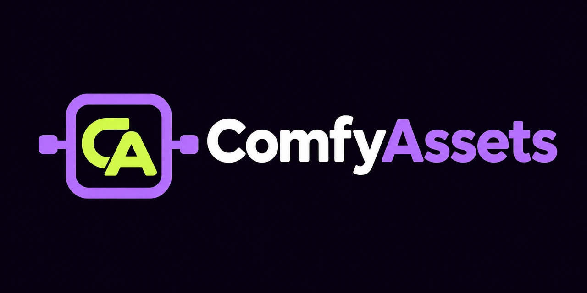

Custom nodes, tools and apps for [ComfyUI](https://github.com/comfyanonymous/ComfyUI), open source and published to the [Comfy Registry](https://registry.comfy.org/publishers/kiko9).

<!-- repos:start -->
<!-- Generated by scripts/update_profile.py; edit the repositories, not this block. -->

## ComfyUI custom nodes

| Project | What it does | Stars |
| --- | --- | ---: |
| [**ComfyUI_PromptManager**](https://github.com/ComfyAssets/ComfyUI_PromptManager) | Professional prompt management system for ComfyUI with advanced search, tagging, star ratings, and integrated image galleries. | 186 |
| [**ComfyUI-KikoTools**](https://github.com/ComfyAssets/ComfyUI-KikoTools) | Simple tools for ComfyUI | 22 |
| [**ComfyUI_Selectors**](https://github.com/ComfyAssets/ComfyUI_Selectors) | ComfyUI_Selectors provides custom nodes that centralize commonly shared parameters—such as scheduler, steps, config, and sampler—and allow you to link these settings to multiple nodes in your workflow. | 10 |
| [**ComfyUI-KikoStats**](https://github.com/ComfyAssets/ComfyUI-KikoStats) | Helpful at a glance stats in ComfyUI | 9 |
| [**kiko-downloader**](https://github.com/ComfyAssets/kiko-downloader) | A node for downloading models, loras, upscalers, you name it! | 4 |
| [**comfyui-harness**](https://github.com/ComfyAssets/comfyui-harness) | A drop-down terminal in the ComfyUI page for your own Claude Code, with an optional bridge that lets it read and edit the open workflow. | 1 |

## Tools and apps

| Project | What it does | Stars |
| --- | --- | ---: |
| [**kiko-flux2-prompt-builder**](https://github.com/ComfyAssets/kiko-flux2-prompt-builder) | A lightweight JSON-style prompt builder for FLUX 2, with camera, lens, lighting, and style presets. | 68 |
| [**kiko-trainer**](https://github.com/ComfyAssets/kiko-trainer) | A fast, friendly desktop-style UI for training FLUX LoRAs locally. | 4 |
| [**Kiko-Creator**](https://github.com/ComfyAssets/Kiko-Creator) | A simple react based stable diffusion inference UI, uses ComfyUI under the covers. | 3 |
| [**ComfyAssets-Toolkit**](https://github.com/ComfyAssets/ComfyAssets-Toolkit) | Shared UI controls and test infrastructure for ComfyAssets custom nodes | 1 |

<!-- repos:end -->

## Get involved

Found a bug or have an idea? Open an issue on the project's repository. If our tools save you time, you can [buy us a coffee](https://buymeacoffee.com/veets).

[comfyassets.com](https://www.comfyassets.com/)
